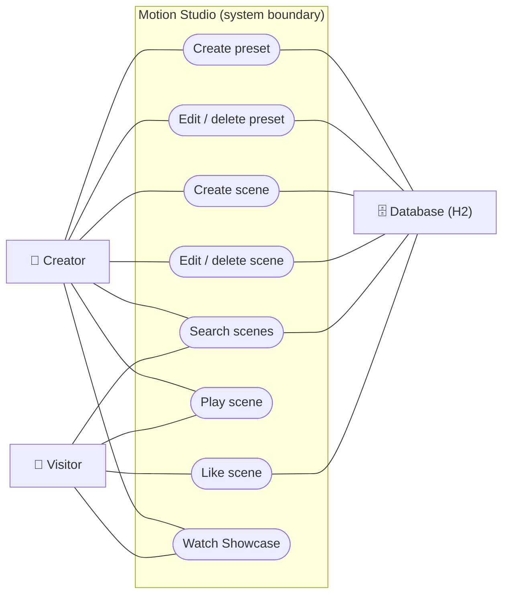

# Motion Studio

A small Spring Boot CRUD application built for **Laboratory 1 – Git Basics**.

Motion Studio is a playground for text animations. You write a piece of text, choose a font,
a color gradient and an **animation preset** (effect + timing), and watch the text appear on
the stage. Scenes are saved to the gallery and can be played one after another in a
fullscreen **Showcase** with transitions between them.

**Who uses it:** students, designers and content creators who want to make short animated
titles (for presentations, social posts or video intros) without learning After Effects or
writing CSS animations by hand.

**Problem it solves:** creating a nice text animation usually needs special software or code.
Motion Studio lets you build, preview, save and present animated text right in the browser.


## Features

- **Presets (CRUD):** named animations built from 14 effects (Fade, Rise, Drop, Blur Focus, Zoom,
  Flip, Bounce, Elastic, Wave, Glitch, Neon, Typewriter, Swing Words, Slide Words), an easing curve,
  duration, delay, per-letter stagger and repeat count. A live preview updates while you edit.
- **Scenes (CRUD):** text + font + size + gradient + preset. Search, play counter and likes.
- **Sessions:** every visitor gets a server-side session (cookie `MS_SID`). It stores likes
  (one like per session) and the recently played scenes.
- **Showcase:** fullscreen slideshow of all scenes (`←` / `→` to navigate, `Esc` to close).
- **Request logging:** every API call is logged with a request id, status, duration and session.

## Tech stack

Java 21, Spring Boot 3.5 (Web, Data JPA, Validation), H2 database,
vanilla HTML/CSS/JS frontend served by Spring Boot, JUnit 5 + MockMvc, Docker.

## Architecture

```
src/main/java/com/nazarkoldun/motionstudio
├── model/        JPA entities (AnimationPreset, Scene) and enums (EffectType, Easing, StudioFont)
├── repository/   Spring Data JPA repositories
├── service/      Business logic and validation rules (PresetService, SceneService)
├── api/          REST controllers, DTOs (records) and the global exception handler
├── session/      SessionManager (in-memory sessions, expiry) + SessionFilter (cookie middleware)
├── middleware/   RequestLoggingFilter (request id, timing, access log)
└── config/       DataSeeder (starter presets and scenes)
```

All components are Spring beans, i.e. **singletons**. A request goes through:
`RequestLoggingFilter → SessionFilter → Controller → Service → Repository → H2`.

## REST API

| Method | Path                       | Description                               |
|--------|----------------------------|-------------------------------------------|
| GET    | `/api/meta`                | Effects, easings and fonts for the forms  |
| GET    | `/api/presets`             | List presets                              |
| GET    | `/api/presets/{id}`        | Get one preset                            |
| POST   | `/api/presets`             | Create a preset                           |
| PUT    | `/api/presets/{id}`        | Update a preset                           |
| DELETE | `/api/presets/{id}`        | Delete a preset (409 if used by a scene)  |
| GET    | `/api/scenes?q=`           | List / search scenes                      |
| GET    | `/api/scenes/{id}`         | Get one scene                             |
| POST   | `/api/scenes`              | Create a scene                            |
| PUT    | `/api/scenes/{id}`         | Update a scene                            |
| DELETE | `/api/scenes/{id}`         | Delete a scene                            |
| POST   | `/api/scenes/{id}/play`    | Count a play, remember it in the session  |
| POST   | `/api/scenes/{id}/like`    | Like / un-like (once per session)         |
| GET    | `/api/session`             | Current session info                      |

Validation errors return `400` with `fieldErrors`, missing entities `404`, conflicts `409`.

## Running

Only Docker is required:

```bash
docker compose up -d --build
docker compose logs -f
docker compose down
```

The application is available at <http://localhost:8080>. Tests run during the image build,
so the image is not created if any of them fail. The H2 database is kept in the
`motion-data` volume, so data survives container restarts (`docker compose down -v` removes it).

## Screenshots

See the [`doc`](doc) directory.

| Presets | Gallery |
|---------|---------|
|  |  |

## User stories

**1. Create an animation preset**

As a creator, I want to build my own animation preset from an effect, easing and timing, so that I can reuse the same animation style in many scenes.

- [ ] The user can choose an effect, easing, duration, delay, stagger and repeat count in one form.
- [ ] A live preview shows the animation while the form is being edited.
- [ ] The preset is saved only when the name and all values are valid; otherwise an error is shown next to the wrong field.

**2. Create a scene**

As a creator, I want to write a text and pick a font, gradient and preset for it, so that I can quickly get a finished animated title.

- [ ] The new scene appears in the gallery right after saving.
- [ ] The scene can be opened and played on the stage with the chosen preset.
- [ ] The user can edit or delete the scene later.

**3. Like a scene**

As a visitor, I want to like the scenes I enjoy, so that the best animations are easy to notice.

- [ ] One click on the heart adds a like, a second click removes it.
- [ ] One session can like a scene only once.
- [ ] The like counter in the gallery updates immediately.

**4. Present scenes in the Showcase**

As a presenter, I want to play all scenes one after another in fullscreen, so that I can show my work to an audience without extra tools.

- [ ] The Showcase opens in fullscreen with one click.
- [ ] `←` / `→` switch scenes and `Esc` closes the Showcase.
- [ ] Every scene shown in the Showcase increases its play counter.

## Actors

- **Creator** — a person who creates, edits and deletes animation presets and scenes.
- **Visitor** — a person who browses the gallery, searches, plays and likes scenes, and watches the Showcase.
- **Database (H2)** — an external system that stores presets and scenes so they are kept between restarts.

## Use cases

| # | Use case              | Actor(s)                     |
|---|-----------------------|------------------------------|
| 1 | Create preset         | Creator, Database            |
| 2 | Edit / delete preset  | Creator, Database            |
| 3 | Create scene          | Creator, Database            |
| 4 | Edit / delete scene   | Creator, Database            |
| 5 | Search scenes         | Visitor, Creator, Database   |
| 6 | Play scene            | Visitor, Creator             |
| 7 | Like scene            | Visitor, Database            |
| 8 | Watch Showcase        | Visitor, Creator             |

## Use case diagram

Simplified use case diagram — actor nodes = stick persons, oval nodes = use cases.



## Planned features (Product Backlog)

1. Create, edit and delete animation presets with live preview.
2. Create, edit and delete scenes (text, font, gradient, preset).
3. Gallery with search by scene text.
4. Fullscreen Showcase with keyboard navigation.
5. Likes and play counter for scenes (one like per session).
6. Export a scene as a GIF / MP4 video.
7. User accounts, so creators own their scenes and presets.
8. Share a scene by a public link.
9. Custom fonts uploaded by the user.
10. Background music for the Showcase.
